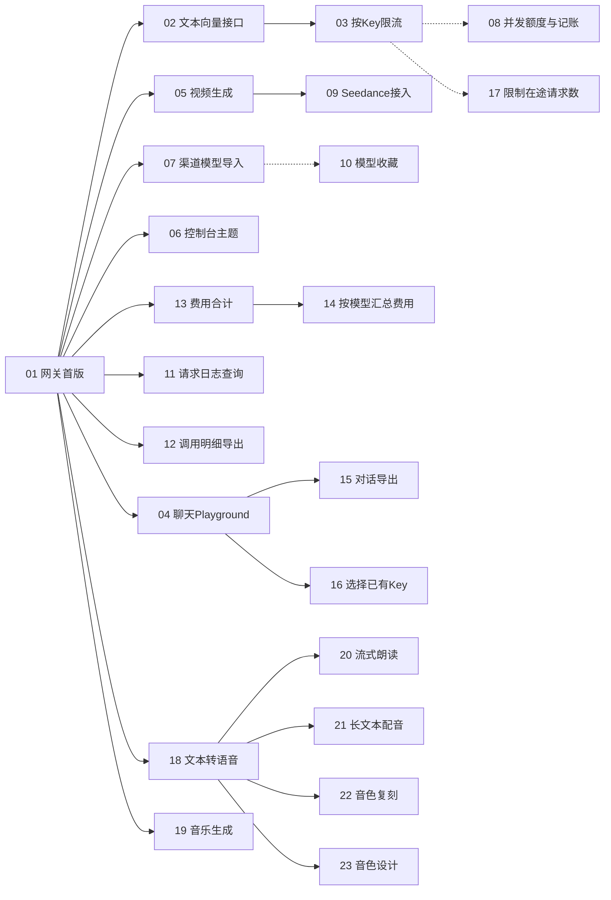

# 模型网关开发需求

请在当前仓库实现以下功能。可以按清单顺序推进，也可以根据已有代码调整顺序或并行开发。

## 全局功能清单

| 编号 | 功能 | 需求 | 参考前序 |
|---|---|---|---|
| 01 | 网关首版 | 参考 new-api 和 LiteLLM，用 Go 和 React 实现模型网关首版；基础要求及所需中间件的连接与隔离信息见仓库根目录《环境说明.md》。 | — |
| 02 | 文本向量接口 | 为网关增加 Embeddings 接口，允许调用方使用现有网关 Key 获取文本向量，并记录本次调用的用量。 | 01 |
| 03 | 按Key限流 | 为网关调用增加限流功能。 | 02 |
| 04 | 聊天Playground | 在控制台增加聊天 Playground，具体要求见随附 PRD。 | 01 |
| 05 | 视频生成 | 增加 MiniMax 视频生成，支持文生视频和首帧图生视频，并在控制台提供任务状态、预览和下载。 | 01 |
| 06 | 控制台主题 | 为控制台增加浅色、深色和跟随系统三种主题，保存用户选择，覆盖所有页面和弹窗。 | 01 |
| 07 | 渠道模型导入 | 支持从上游获取模型列表并勾选导入渠道，保留手动填写和模型别名，获取失败时保留已有配置。 | 01 |
| 08 | 并发额度与记账 | 为聊天和 Embeddings 增加并发额度控制和准确记账，具体要求见随附 PRD。 | 03 |
| 09 | Seedance接入 | 在现有视频生成页增加 Seedance，支持选择厂商并完成文生视频和首帧图生视频。 | 05 |
| 10 | 模型收藏 | 为模型列表增加收藏、取消收藏和仅看收藏功能，并在下次打开时保留收藏记录。 | 07 |
| 11 | 请求日志查询 | 在调用日志页增加按请求 ID 精确查询的功能。 | 01 |
| 12 | 调用明细导出 | 增加调用明细导出功能，供财务对账。 | 01 |
| 13 | 费用合计 | 在用量页增加所选时间段的费用合计，翻页时保持整个时间段的合计金额。 | 01 |
| 14 | 按模型汇总费用 | 在费用合计下增加按模型分组的费用明细，沿用当前选择的时间段。 | 13 |
| 15 | 对话导出 | 为 Playground 增加对话导出功能，将当前会话的用户消息和模型回复按顺序导出为 Markdown。 | 04 |
| 16 | 选择已有Key | Playground 支持直接选择已有网关 Key 发送对话，显示该 Key 可用的模型，免去手工复制密钥。 | 04 |
| 17 | 限制在途请求数 | 增加每把 Key 的并发请求数上限，超过上限时提示稍后重试，请求结束后释放名额。 | 03 |
| 18 | 文本转语音 | 增加 MiniMax 文本转语音功能，支持选择系统音色、试听和下载生成的语音。 | 01 |
| 19 | 音乐生成 | 支持按风格描述和歌词生成音乐，提供试听和音频下载。 | 01 |
| 20 | 流式朗读 | 为文本朗读增加边生成边播放和停止播放功能。 | 18 |
| 21 | 长文本配音 | 支持将长文本提交为后台配音任务，刷新页面后可继续查看进度并下载成品。 | 18 |
| 22 | 音色复刻 | 支持用已获授权的样音创建专属音色，预览后可选用该音色朗读新文本。 | 18 |
| 23 | 音色设计 | 支持根据文字描述设计音色，提供预览，并允许用选定的音色朗读另一段文案。 | 18 |

## 功能依赖参考

实线表示后项会用到前项提供的能力，虚线表示建议衔接的工作。两项也可以一起实现。

## 01 网关首版 · 补充资料

参考项目

- https://github.com/QuantumNous/new-api
- https://github.com/BerriAI/litellm

## 04 聊天Playground · 补充资料

请按以下 PRD 实现，并用中文说明实现结果和验证情况。

# Playground：在控制台直接试用聊天模型

## 问题与目标

管理员已经配置了渠道和网关 Key，但试用模型仍需手写 API 请求。增加一个 Playground，让用户在当前控制台完成“选择模型—发送对话—查看结果—调整参数后重试”。

## 首版范围

- 使用现有管理员登录进入 Playground。用户选择可用模型，并使用自己提供的网关 Key 发起请求；沿用 Key 的模型权限、额度、限流和请求日志。
- 支持文本多轮对话、可编辑系统提示词、温度和最大输出长度。参数受选中模型支持范围约束，不支持时给出明确说明。
- 支持流式显示、停止生成、清空当前对话和重新发送。重试应清楚表明会发起新请求、可能产生新费用。
- 显示实际返回的 Token 用量、请求耗时和请求标识；上游不提供用量时，标明不可用或估算，不能伪装精确值。
- 无可用模型、权限不足、额度不足、限流、上游失败、连接中断均显示可理解的反馈。可通过请求标识定位已有请求日志。
- 网关 Key 只用于当前页面会话，不写入 URL、浏览器持久存储或应用日志；不向浏览器暴露渠道密钥。

## 关键规则

对话必须经过真实网关，不能由页面直接绕过网关调用上游。停止生成应停止页面读取并尽力取消上游请求，但不承诺取消后没有费用。切换模型、清空及重试的行为要让用户能预期，不暗中重复提交。

## 验收

1. 使用有效网关 Key，完成两轮真实聊天，第二轮包含上一轮上下文；流式内容可逐步显示。
2. 停止一个正在生成的回复后，页面可继续操作，并能发送下一条请求；没有无提示的重复请求。
3. 调整参数后重新发送，实际请求与界面所选参数一致。
4. 无效 Key、无权访问的模型、额度不足及上游失败都能看到明确错误；权限和额度规则与现有 API 一致。
5. 可关联真实请求日志；刷新页面后不恢复网关 Key；页面在浅色功能未合入时也能正常使用。

## 本期不做

不包含视频、图像、语音、工具执行、Agent 工作流、多人共享对话或服务器端聊天历史；不依赖本批其他四个 Issue 才能独立验收。

交付包含可试用页面、使用说明及真实调用证据。测试用假上游可用于回归，但不能代替真实聊天验收。

## 08 并发额度与记账 · 补充资料

请按以下 PRD 实现，并用中文说明实现结果和验证情况。

# 并发调用下的额度控制与准确记账

## 问题与目标

当前网关在请求结束后累计消耗，再据此判断后续请求是否可用。同一 Key 的多个请求同时进入时，可能都看到同一笔剩余额度并全部放行。目标是让并发请求共享同一份可用额度，同时准确记录实际费用。

## 首版范围

覆盖当前已有的聊天和 Embeddings 调用，包含流式与非流式。保持现有 Key 配置入口、模型权限、RPM 限制及无限额度用法。部署范围是当前单节点网关，不引入多节点账务平台。本批新视频功能的额度接入不作为本 Issue 的前置条件，也不能默认当作已覆盖。

## 业务规则

- 有限额度 Key 的可用额度同时考虑已结算费用和在途请求占用的额度；同一余额不能被多个并发请求重复占用。
- 请求发往上游前应有可信的费用上界或受控上限，并据此判断能否放行；没有足够额度则明确拒绝。无法得到可信上界时应明确拒绝或要求补足必要配置，不能假装实现了严格防超用。
- 请求完成后按可核验的实际用量结算，释放未使用的预留；前端或日志能区分实际费用、估算费用和待核实状态。
- 未调用上游或已确认未产生用量的失败请求不扣费用。取消、断流、超时及上游报错不能一律视为免费；已产生的用量仍需结算，未知费用不能默认为零。
- 同一次网关请求发生内部重试、渠道切换或重复收到完成通知时，不得重复记同一笔费用；确实发生的多次上游计费不能隐去。
- 服务重启及异常退出后，已结算费用不能丢失，在途额度有正式恢复或核实路径；不能永久锁住额度，也不能直接清零放行。
- 不同 Key 的余额独立。无限额度 Key 仍统计用量，但不因余额被拒绝。

## 验收

1. 配置有限额度，使其仅足够一个有明确费用上界的请求，同时发起五个请求；不得将同一笔余额重复放行。
2. 同时完成多次允许的调用，最终费用等于各请求应计费用之和，没有漏记或重复记账。
3. 覆盖成功、调用前失败、超时、取消、断流及渠道切换，分别核对实际费用和剩余预留。
4. 在有在途请求时重启测试实例，通过正式恢复路径核对账务；不手工改数据库或依赖开发者救援。
5. 不同 Key 及无限额度 Key 行为正确；原有模型权限和 RPM 限制不退化。

## 本期不做

不包含充值、支付、发票、组织账户、分布式账本或通用计费平台。不能为了通过测试而把所有请求全局串行化。

交付包含明确的额度规则、并发与恢复验证证据、现有安装的升级说明，以及仍无法精确计费的上游场景。受控上游可验证确定性的账务边界，真实上游调用用于验证正常接入；两类证据须区分。

# 模型网关环境说明

控制台、用户提示、任务回复和使用说明使用简体中文。测试控制台的用户名和密码均为 `admin`。

业务数据统一存入 SQLite。每次运行在专用工作区使用独立文件，例如 `data/exp_0042.sqlite`。通过 `SQLITE_PATH` 指定路径，首次启动创建数据库并执行迁移，重启和后续功能沿用同一文件。可选中间件以本轮运行编号（如 `exp_0042`）隔离资源。

| 中间件 | 连接信息从哪里取 | 本工作区的资源 |
|---|---|---|
| SQLite | `SQLITE_PATH`，由本地文件路径指定 | 全部业务表、迁移和账务记录均在本轮专属文件内。 |
| 消息队列（按需） | `QUEUE_URL`，在工作区提供队列时注入 | 队列如 `exp_0042_audio`。使用 Kafka 时，topic 和消费组分别如 `exp_0042_audio`、`exp_0042_workers`，分区位于本工作区的 topic 内。 |
| Redis（按需） | `REDIS_URL`，在工作区提供缓存时注入 | 键、锁和计数器统一使用 `exp_0042:` 前缀，如 `exp_0042:rpm:key1`。 |

连接值保存在工作区私有配置中。读取、消费和清理操作仅针对本工作区的资源。

## 上游模型与调用材料

以下是已有的接入线索。表中的模型名来自历史配置，本次使用范围、可用模型和账号权限以工作区实际分配为准。

| 用途 | 已登记的信息 | 真实调用前还需核对 |
|---|---|---|
| 聊天 | DeepSeek，`https://api.deepseek.com/v1`，历史模型 `deepseek-v4-flash`、`deepseek-v4-pro`，凭证引用 `DEEPSEEK_API_KEY` | 本工作区是否获准使用，以及实际可用的模型 |
| 向量 | 网关接口 `/v1/embeddings`；智谱上游 Base URL `https://open.bigmodel.cn/api/paas/v4`，模型 `embedding-3` | 从工作区读取授权凭证 `BIGMODEL_API_KEY`；首次真实请求核对向量与用量 |
| MiniMax 视频 | `https://api.minimaxi.com`，历史配置名 `MiniMax-H3` | 核对账号实际可用的视频模型，以及文生视频和首帧图生视频两种权限 |
| MiniMax 音频 | 已有 MiniMax 渠道线索 | 分别核对普通、流式、异步长文本语音、音乐、音色设计、音色复刻的入口和权限 |
| Seedance 视频 | `https://ark.cn-beijing.volces.com/api/v3`，历史模型 `doubao-seedance-2-0-260128` | 本工作区凭证引用、可用模型或推理接入点，以及两种视频模式的权限 |

音色复刻使用说话人已授权用于复刻的样音，文件路径和授权范围随工作区提供。本轮付费调用的人民币总预算由任务发起方指定。本文尚未登记样音路径或预算金额。凭证通过工作区私有配置注入。
